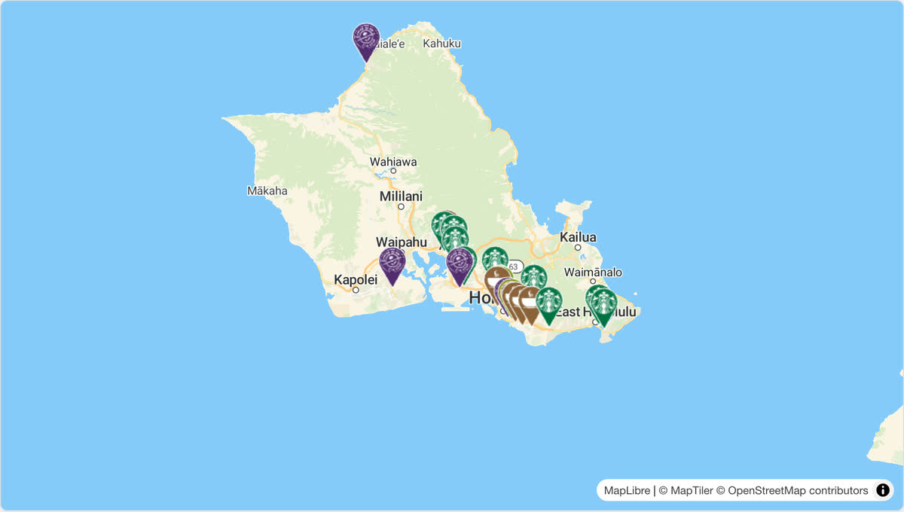

# @mapconductor/reactnative-for-maptiler

MapConductor の MapTiler 用 React Native プロバイダーです。Web 用の
`@mapconductor/react-for-maptiler` とは別パッケージで、Android の
`com.mapconductor:for-maptiler` と iOS の `MapConductorForMapTiler` を薄くラップします。

## デモ

[](https://demo-react.mapconductor.com/maptiler/map/en)

画像は Web 版（[`@mapconductor/react-for-maptiler`](https://github.com/MapConductor/react-for-maptiler)）の[ライブデモ](https://demo-react.mapconductor.com/maptiler/map/en)です。同じ店舗マップを React Native で書くと次のとおりです。

```tsx
import { useMemo, useState } from 'react';
import { Text } from 'react-native';
import {
  createGeoPoint,
  createMapCameraPosition,
  createMarkerState,
  type MarkerState,
} from '@mapconductor/js-sdk-core';
import { InfoBubble, Markers } from '@mapconductor/js-sdk-react/native';
import { MapTilerDesign, MapTilerMapView, useMapTilerViewState } from '@mapconductor/reactnative-for-maptiler';

const STORES = [
  { id: 'waikiki', name: 'Waikiki', latitude: 21.2793, longitude: -157.8292 },
  { id: 'kailua', name: 'Kailua', latitude: 21.3972, longitude: -157.7394 },
  { id: 'haleiwa', name: 'Haleiwa', latitude: 21.5928, longitude: -158.1034 },
];

const INITIAL_CAMERA = createMapCameraPosition({
  position: createGeoPoint({ latitude: 21.38, longitude: -157.93 }),
  zoom: 10,
});

export function StoreMap() {
  const mapViewState = useMapTilerViewState({
    mapDesignType: MapTilerDesign.Streets,
    cameraPosition: INITIAL_CAMERA,
  });
  const [selected, setSelected] = useState<MarkerState | null>(null);
  const markers = useMemo(
    () =>
      STORES.map(store =>
        createMarkerState({
          id: store.id,
          position: createGeoPoint({ latitude: store.latitude, longitude: store.longitude }),
          extra: store,
          onClick: marker => setSelected(marker),
        }),
      ),
    [],
  );

  return (
    <MapTilerMapView state={mapViewState} style={{ flex: 1 }} onMapClick={() => setSelected(null)}>
      <Markers states={markers} />
      {selected && (
        <InfoBubble marker={selected}>
          <Text>{(selected.extra as (typeof STORES)[number]).name}</Text>
        </InfoBubble>
      )}
    </MapTilerMapView>
  );
}
```

## 使い方

```tsx
import {
  MapTilerDesign,
  MapTilerMapView,
  useMapTilerViewState,
} from '@mapconductor/reactnative-for-maptiler';

export function MapPage() {
  const state = useMapTilerViewState({
    id: 'main-map',
    mapDesignType: MapTilerDesign.Streets,
  });

  return <MapTilerMapView state={state} style={{ flex: 1 }} />;
}
```

通常のオーバーレイは `@mapconductor/js-sdk-react` の `Marker`、`Markers`、
`Polyline`、`Polygon`、`Circle`、`GroundImage`、`RasterLayer` を子として宣言します。
大量のマーカーには、1 マーカーごとの React effect を作らない `Markers` を使用してください。

## ★ Android と iOS で中身が違う

**このプロバイダは 2 つのプラットフォームで別の地図エンジンを使います。**

| | 実体 | マーカーの描き方 | 同期投影 |
|---|---|---|---|
| Android | MapTiler 独自の WebView SDK（`com.maptiler.maptilersdk`、中身は MapLibre GL JS） | Compose のオーバーレイ（`MapTilerProjectedAnnotation`） | SDK に無い。コアの `WebMercatorScreenProjection` で埋めている |
| iOS | MapLibre ネイティブ（`MLNMapView`）に MapTiler のスタイル URL を差す | MapLibre のシンボルレイヤ | MapLibre の `convert` |

prop も振る舞いも揃えてありますが、**片方で通ったからもう片方も通るとは限りません。**
変更したら必ず両方の実機で確かめてください。

## ネイティブ設定

- Android: MavenLocal の `com.mapconductor:for-maptiler:1.2.0` が必要です。
  API キーは application manifest の `MAPTILER_API_KEY` meta-data へ設定します。
- iOS: `MapConductorForMapTiler` を CocoaPods で解決します（`MapLibre` はその podspec の
  `s.dependency` から降ります）。API キーは Info.plist の `MapTilerAPIKey` へ設定します。

キーは環境変数、Gradle property、または git 管理外の設定ファイルから注入し、
リポジトリへコミットしないでください。iOS 側は値に `$(...)` が残っていれば
**展開されなかったビルド設定のプレースホルダ**として弾きます（`MapTilerMapHost.resolveApiKey`）。
弾かれないと地図が真っ白になるだけで理由が出ません。

## 開発時の確認

```bash
npm run build --workspace @mapconductor/reactnative-for-maptiler

# android-for-maptiler を変更したら publishToMavenLocal が必須
env JAVA_HOME="/Applications/Android Studio.app/Contents/jbr/Contents/Home" \
  ./gradlew :android-for-maptiler:publishToMavenLocal
```

デザイン ID は `getValue()`（`mapDesign_id=...,style=...`）ではなく **id そのもの**を
ネイティブへ送り、android / iOS とも `MapTilerDesign.fromId` で引きます。
web の形式を送ると**どのデザインにも一致せず、黙って Streets のまま**になります。

クリックのカスケードと座標投影は各ネイティブドライバー側の責務です。
RN 層で別の当たり判定や投影を書かないでください。
